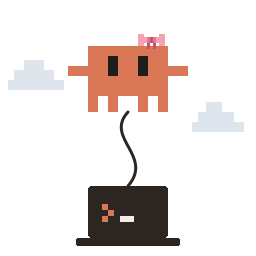

<p align="center"></p>

<h1 align="center">claudette</h1>

<p align="center">
  <a href="https://github.com/oshinop/claudette/actions/workflows/ci.yml"></a>
  <a href="https://github.com/oshinop/claudette/releases/latest"></a>
  <a href="LICENSE"></a>
  
  
</p>

A drop-in `claude` that runs Claude Code on another machine, reached over ssh, and its tools on this
one: your files, builds and git stay on the laptop, while the remote machine holds the login.

## What you get

- A drop-in `claude`: anything that launches Claude Code launches claudette unchanged, and your
  settings, permission rules, hooks, skills, plugins and MCP servers apply as they would locally.
- A light laptop: Claude Code itself runs on the remote machine, so a modest laptop keeps many agents
  going at once, with no Claude Code install or login of its own.
- No telemetry from the laptop: claudette sends none, and Claude Code's own comes from the remote
  machine.
- Sessions that survive the laptop sleeping or the network dropping.

## Use cases

- [T3 Code](https://github.com/pingdotgg/t3code) and [Paseo](https://paseo.sh) run many Claude
  threads at once; with claudette, all of them run on a Mac mini at home instead of the laptop
  (setup: [T3 Code](docs/hosts.md#t3-code), [Paseo](docs/hosts.md#paseo)).
- [magpie](https://usemagpie.ai) lends a Claude subscription to Codex, OpenCode and other agents;
  with claudette, the subscription signed in on the remote machine serves the laptop's agents
  ([setup](docs/hosts.md#magpie)).
- Clients that speak [ACP](https://agentclientprotocol.com), such as Zed, JetBrains AI Assistant,
  [Toad](https://github.com/batrachianai/toad) and [acpc](https://github.com/AkaraChen/acpc), run
  Claude through the [claude-agent-acp](https://github.com/agentclientprotocol/claude-agent-acp)
  adapter; with claudette behind it, Claude runs on the remote machine and works on the laptop's
  files ([setup](docs/hosts.md#acp-clients)).

## Set up

```sh
curl -fsSL https://raw.githubusercontent.com/oshinop/claudette/main/scripts/install.sh | CLAUDETTE_HOST=mini sh
claudette +doctor                               # checks ssh and the remote machine
ln -s "$(command -v claudette)" ~/bin/claude    # a folder on PATH, ahead of any other claude
```

[Installation and configuration](docs/configuration.md) covers what both machines need, the other
settings, and why a link rather than an alias.

## Use

Run `claude` as you always do. [Usage](docs/usage.md) covers what's specific to claudette and what
to watch out for, and [hosts](docs/hosts.md) how to point T3 Code, Paseo, an ACP client or an Agent
SDK program at it.

## Development

Building needs Rust 1.88 or later through rustup, and [zig](https://ziglang.org) with
[cargo-zigbuild](https://github.com/rust-cross/cargo-zigbuild), which link the static Linux builds:

```sh
brew install zig && cargo install --locked cargo-zigbuild
scripts/build.sh     # dist/claudette-{darwin,linux}-{arm64,x64}; the macOS builds need a Mac
cargo test           # unit tests
scripts/test.sh      # end-to-end tests, in containers (needs Docker)
```

CI runs the unit tests on Linux and macOS, the four builds with the installer, and the end-to-end
tests. Pushing a tag that matches `Cargo.toml`'s version, such as `v0.1.0`, publishes a release with
the builds and their `SHA256SUMS`, which the install script downloads.

## Contributing

Issues and pull requests are welcome on [GitHub](https://github.com/oshinop/claudette).

- **Bug reports:** include the output of `claudette +doctor`, both machines' operating systems, and
  the host if one launched claudette (T3 Code, Paseo, an ACP client). The `log` setting
  ([configuration](docs/configuration.md#configure)) records every frame and mount request. It
  contains prompts and file contents, so share only the relevant part.
- **Hosts and clients:** a report that a host from [hosts](docs/hosts.md) works or doesn't, with
  its version and what you tried, helps as much as code. Most of the hosts listed there are untested.
- **Pull requests:** `cargo test` and `scripts/test.sh` should pass. CI runs both, plus the four
  release builds and the installer. A change in behavior comes with a test that would catch it
  breaking: unit tests sit beside the code, and end-to-end tests in `tests/e2e` drive the real
  Claude Code in containers ([testing](docs/testing.md)). Update the docs the change makes stale,
  including the coverage list in `docs/testing.md`. There is no formatter configuration: follow the
  style of the file you change.

## Acknowledgements

The idea of running Claude Code remotely while replacing its file and shell tools with local ones
of the same names and inputs comes from [cc-remote](https://github.com/AkaraChen/cc-remote) by
AkaraChen.

## More

- [Design](docs/design.md): the workspace, settings, MCP servers, the relay
- [Startup latency](docs/latency.md)
- [Testing](docs/testing.md)
- [Limitations](docs/limitations.md)
