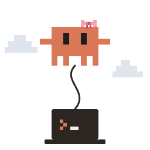

<p align="center"></p>

<a id="claudette"></a>
<h1 align="center">claudette</h1>

<p align="center">
  <a href="https://github.com/oshinop/claudette/actions/workflows/ci.yml"></a>
  <a href="https://github.com/oshinop/claudette/releases/latest"></a>
  <a href="LICENSE"></a>
  
  
</p>
<p align="center"><a href="README.md">English</a> · 简体中文</p>

可直接替代 `claude`：通过 ssh 在另一台机器上运行 Claude Code，其 tool 则在本机运行。文件、构建和 git 都留在本地机器上，登录状态则保留在远程机器上。

<a id="what-you-get"></a>
## 你能获得什么

- 可直接替代 `claude`：任何启动 Claude Code 的程序都能原样启动 claudette；设置、权限规则、hook、skill、插件和 MCP server 都会像在本地运行时一样生效。
- 减轻本地机器的负载：Claude Code 本身在远程机器上运行，因此配置不高的本地机器也能同时运行多个 agent，无需在本地机器上安装或登录 Claude Code。
- 本地机器不发送遥测数据：claudette 不发送任何遥测数据，Claude Code 自身的遥测数据也来自远程机器。
- 本地机器休眠或网络中断后，会话仍能继续保留。

<a id="use-cases"></a>
## 使用场景

- [T3 Code](https://github.com/pingdotgg/t3code) 和 [Paseo](https://paseo.sh) 会同时运行多个 Claude 线程；使用 claudette 后，它们都在家中的 Mac mini 上运行，而不是在本地机器上运行（配置方法：[T3 Code](docs/zh-CN/hosts.md#t3-code)、[Paseo](docs/zh-CN/hosts.md#paseo)）。
- [magpie](https://usemagpie.ai) 将 Claude 订阅提供给 Codex、OpenCode 和其他 agent 使用；使用 claudette 后，远程机器上已登录的订阅就能供本地机器上的 agent 使用（[配置方法](docs/zh-CN/hosts.md#magpie)）。
- 支持 [ACP](https://agentclientprotocol.com) 的客户端，例如 Zed、JetBrains AI Assistant、[Toad](https://github.com/batrachianai/toad) 和 [acpc](https://github.com/AkaraChen/acpc)，通过 [claude-agent-acp](https://github.com/agentclientprotocol/claude-agent-acp) 适配器运行 Claude；在适配器后接入 claudette 后，Claude 就会在远程机器上运行，并处理本地机器上的文件（[配置方法](docs/zh-CN/hosts.md#acp-clients)）。

<a id="set-up"></a>
## 安装配置

```sh
curl -fsSL https://raw.githubusercontent.com/oshinop/claudette/main/scripts/install.sh | CLAUDETTE_HOST=mini sh
claudette +doctor                               # 检查 ssh 和远程机器
ln -s "$(command -v claudette)" ~/bin/claude    # 此目录需在 PATH 中，且排在其他 claude 所在目录之前
```

之后可用 `claudette +update` 安装较新的发行版；有新版本时，claudette 自身的命令会提示。[安装与配置](docs/zh-CN/configuration.md)介绍了两台机器各自的要求、其他设置、更新方法，以及为什么使用链接而不是别名。

<a id="use"></a>
## 使用

像往常一样运行 `claude` 即可。[使用指南](docs/zh-CN/usage.md)介绍了 claudette 特有的用法和注意事项；[宿主（host）](docs/zh-CN/hosts.md)介绍了如何让 T3 Code、Paseo、ACP 客户端或 Agent SDK 程序使用它。

<a id="development"></a>
## 开发

构建需要通过 rustup 安装的 Rust 1.88 或更高版本，以及 [zig](https://ziglang.org) 和 [cargo-zigbuild](https://github.com/rust-cross/cargo-zigbuild)，后两者用于链接静态 Linux 构建产物：

```sh
brew install zig && cargo install --locked cargo-zigbuild
scripts/build.sh     # dist/claudette-{darwin,linux}-{arm64,x64}; macOS 构建产物需要在 Mac 上构建
cargo test           # 单元测试
scripts/test.sh      # 在容器中运行端到端测试（需要 Docker）
```

CI 会在 Linux 和 macOS 上运行单元测试，测试四种构建产物及安装程序，并运行端到端测试。推送与 `Cargo.toml` 中版本号一致的标签（如 `v0.1.0`），就会发布包含构建产物及其 `SHA256SUMS` 的发行版，供安装脚本下载。

<a id="contributing"></a>
## 参与贡献

欢迎在 [GitHub](https://github.com/oshinop/claudette) 上提交 issue 和 pull request。

- **报告缺陷**：请附上 `claudette +doctor` 的输出、两台机器的操作系统，以及启动 claudette 的宿主（如有，例如 T3 Code、Paseo、ACP 客户端）。`log` 设置（参见[配置](docs/zh-CN/configuration.md#configure)）会记录每一帧和每个挂载请求，其中包含提示词和文件内容，因此请只分享相关部分。
- **宿主与客户端**：报告[宿主列表](docs/zh-CN/hosts.md)中的某个宿主能否正常工作，并附上版本号和尝试过的操作，与贡献代码同样有帮助。列表中的大多数宿主尚未经过测试。
- **Pull request**：`cargo test` 和 `scripts/test.sh` 应当通过。CI 会运行这两项检查，还会测试四种发行版构建产物及安装程序。行为变更应附带能捕获该行为被破坏的测试：单元测试放在代码旁，`tests/e2e` 中的端到端测试则在容器内驱动真实的 Claude Code（参见[测试](docs/zh-CN/testing.md)）。请更新因变更而过时的文档，包括 `docs/testing.md` 中的覆盖范围列表，以及 `docs/zh-CN` 中对应的中文版（本文件对应 `README_zh-CN.md`）。项目没有格式化工具配置，请遵循所修改文件的风格。

<a id="acknowledgements"></a>
## 致谢

在远程运行 Claude Code，同时用名称和输入相同的本地 tool 替换其文件与 shell tool，这一思路来自 AkaraChen 的 [cc-remote](https://github.com/AkaraChen/cc-remote)。

<a id="more"></a>
## 更多

- [设计](docs/zh-CN/design.md)：工作区、设置、MCP server、中继（relay）
- [启动延迟](docs/zh-CN/latency.md)
- [测试](docs/zh-CN/testing.md)
- [限制](docs/zh-CN/limitations.md)
