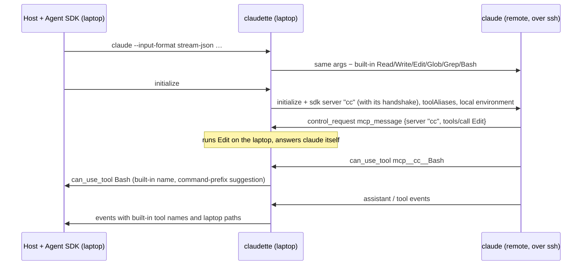
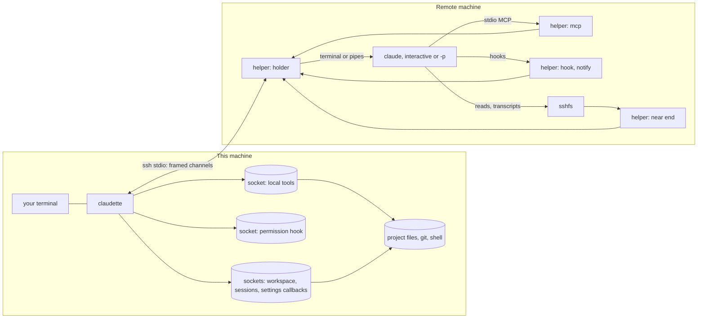
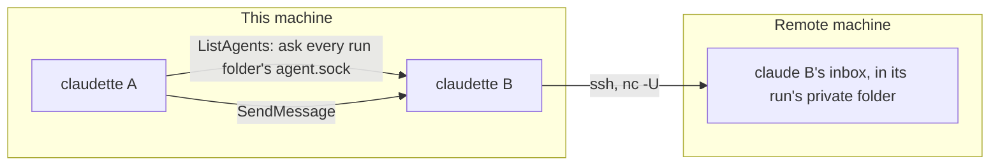

# Design

claudette looks at its arguments and takes one of three paths:

| Arguments | Path | How tools reach this machine |
|---|---|---|
| `--input-format stream-json --output-format stream-json`, which the Agent SDK passes | SDK relay | the SDK's control channel, on the same ssh connection |
| Claude Code's own commands: `auth`, `doctor`, `--version`, `--help` and the rest (`mcp` is claudette's own, and `plugin` works on this machine's plugin store: see [MCP servers](#tools-settings-and-mcp-servers) and [Plugins](#plugins)) | passthrough, run remotely as is | not needed |
| `+…`: claudette's own commands (`claudette +help`); the prefix is the `prefix` setting | here | not needed |
| Anything else: interactive, a prompt, `-p` | direct | the helper on the remote machine as claude's stdio MCP server and hooks, connected to Unix sockets the holder serves there and carries back here |

Both tool paths mount the workspace, serve the same local tools and make the same permission
decisions. They also apply the caller's tool restrictions to the local tools: `--tools`, and bare
tool names in `--allowedTools` and `--disallowedTools`.

## The workspace

Each run serves the project over SFTP on a Unix socket that the helper serves on the remote machine, where
`sshfs -o passive` mounts it. claude runs in the mounted project:

- The remote folder is `~/.claudette/ws/<machine>/<name>-<hash>`. `<machine>` is a hash of this
  machine's OS identity (the hardware UUID on macOS, `machine-id` on Linux), so nothing is stored and
  renaming the Mac changes nothing; `<hash>` is of the project's real path. Each project, and so each
  worktree, has its own folder.
- The mount is read-only, except for Claude Code's own files: `.claude/`, `.mcp.json` and
  `CLAUDE*.md`. `.git` and `node_modules` are not served, and neither is what git ignores
  (`.gitignore` files, `.git/info/exclude`, the global excludes file), so the remote Claude Code's
  file index sees what a local claude's `@` file picker would and never walks build output over the
  network. Claude Code's own files show even when ignored, and `"respectGitignore": false` in its
  settings serves ignored files too. Nothing outside the project is reachable, through `..` or a
  symlink.
- On Linux, bubblewrap gives each session a private mount at the stable folder, so sessions in one
  project never share a mount. Without bubblewrap (macOS), the mount is the folder itself, or a
  sibling of it while another session holds it.
- The remote claude always runs confined: it sees nothing of the remote home folder but the
  workspace, Claude Code's own state (`~/.claude`, `~/.claude.json`) and its installation. It cannot
  read other projects or write outside them. bubblewrap enforces this on Linux, `sandbox-exec` on
  macOS; a remote machine with neither refuses the session. On macOS the profile leaves the login
  Keychain reachable: reading and updating a generic password, through the `security` tool and
  through Security.framework, was tested under it.
- The mount and the run's sockets go away when claude exits, however it exits. If the mount ends
  early (sshfs crashed), claudette says so on stderr.

Through the mount the remote claude loads the project's settings, skills, commands, agents and
output styles itself, and `@` mentions and autocomplete show your files. Its own file and shell work
still goes through the local tools.

### The near end of a mount

Every mount of this machine (the project, the sessions folder, your user content, the plugins) goes
through the helper on the remote machine (`__helper sftp`), which sshfs talks to in place of a plain
relay to the run's socket. On a slow link each request claude makes through a mount is claude
waiting, one after another, so the near end answers what it already knows:

- **A warm start.** Before the run starts, claudette asks each mount's own server here for what claude
  reads first: the server's greeting, the project root's listing, `.claude/` and `.mcp.json`, your
  skills, agents, commands and output styles, the plugins' views, the sessions folder's listing and
  its auto memory. Markdown and JSON files up to 64 KB come with their contents, up to 256 KB a
  mount. It travels with the run's first frames. Since the answers come from the same server, hidden
  names stay hidden and settings files arrive as their views. The mounts come up, and claude starts,
  without waiting for the laptop.
- **A short cache.** Attributes and complete listings, warm or fetched, answer for 10 s; a complete
  listing also answers that a name is not there. sshfs's own cache, which kept them for 20 s, is off
  under the near end. A change made through the mount drops what it touches. A change made on the
  laptop shows within those 10 s, as it showed within sshfs's 20 s before.
- **Write-behind** for transcripts (see [Sessions](#sessions)).

Anything else goes to the laptop as before.

The environment prompt includes the working directory's and its ancestors' memory files. When a local
Read, Edit, Write or NotebookEdit first touches a file below a working directory, the tool result also
includes each not-yet-loaded `CLAUDE.md`, `.claude/CLAUDE.md` and `CLAUDE.local.md` in that path, from
the nearest directory last. A `Read` deny rule skips a memory file. This matches Claude Code's lazy
loading of subdirectory memory without repeating the files already in the prompt.

## The helper

Sessions run under the helper: claudette's own binary, run on the remote machine. Nothing is
installed: on a session's first connection claudette checks for the build for the remote
machine's platform in `~/.claudette/bin/<sha256 prefix>/claudette` and copies it there if it
is missing (a temporary name, checked against its checksum, then renamed; the two newest builds are
kept). A release carries builds for macOS and Linux on arm64 and x86-64 next to the executable, so a
Linux laptop can drive a Mac and the other way round. `claudette +doctor` makes the same
check and reports the helper's version.

For each run the helper starts a holder, detached from ssh, with its state in
`/tmp/claudette-<run>.*` (mode 0600, removed at the end). The holder runs claude (on a terminal
it owns for the interactive interface, on pipes otherwise) and serves the run's Unix sockets: the
local tools, the permission hook, the mounts, the settings callbacks. ssh's own stdio carries
everything, as numbered frames each side acknowledges, in place of `ssh -R` forwards, so a run that
crashes leaves nothing on the shared ssh connection.

Nothing private goes on the remote command line, which any user of the remote machine can read
(`ps`). claude's environment comes with the run's first frame and the holder sets it; the session's
settings, the appended system prompt (your `CLAUDE.md` files, git status), the MCP configuration and
the mounts' warm starts are files only the remote user can read, sent as frames ahead of it, written
by the holder and removed at the end. The first connection sends them right behind its greeting,
without waiting for the helper's. A command passed through as is (`claude auth`, `--version`) gets
its environment from such a file, saved over ssh's stdin first, which it reads and removes before
claude starts.

When the connection drops (the laptop sleeps, the network changes, ssh dies), the session waits
instead of ending:

- claude keeps running on the remote machine. Its reads through the mounts, its tool calls and
  messages to it simply wait; nothing fails.
- claudette reconnects, after one second and then backing off to every 15 seconds, on a new ssh
  connection, and says so on stderr. Both sides send again the frames the other had not acknowledged,
  so nothing is lost or repeated.
- The holder keeps a session whose claudette never comes back for `detach_timeout` (12 hours
  by default), then stops claude and cleans up. A new claudette cannot take over a waiting session:
  if this machine's process is gone, the session is too.

The helper runs outside the sandbox; claude and everything it starts stay inside it.

## Sessions

A project's sessions live on this machine, in `~/.claude/projects/<project>` (or under
`CLAUDE_CONFIG_DIR`), where a local claude keeps them. Each run serves that folder over SFTP too. The
remote machine mounts it, and the run's own Claude Code folder shows it as claude's sessions folder
for the workspace, `projects/<workspace>` (see
[Tools, settings and MCP servers](#tools-settings-and-mcp-servers)). It is a mount beside that folder
rather than inside it, because neither macFUSE nor fusermount allows a mount on a FUSE volume. So,
with no copying:

- `--continue`, `--resume <id>` and the `/resume` list see every session of the project: the ones a
  local claude wrote before you switched, and the ones started through claudette, from a terminal
  or from a host.
- Hosts find their transcripts where they look (T3 Code before it resumes a thread, the SDK's
  `forkSession`), and a fork made here resumes on the remote machine.
- The remote machine keeps no session history on its disk. Sessions it kept for the project before
  move into the folder on the first run (a move that fails is tried again on the next).
- What claude writes has the remote folder's paths turned into this machine's, one complete line at a
  time, so the transcripts read as a local claude's. Nothing outside the folder is reachable, through
  `..` or a symlink.

A transcript is written by the claude whose session it is and nobody else, so the near end of the
sessions mount writes it behind. It keeps a copy of each transcript claude creates or appends to, as
this machine has it (the same code turns the remote paths into this machine's), and answers claude's
opens, writes, lookups and reads of it at once. Every write still leaves for this machine as it is
made, in order, on a handle the near end chose, so the laptop never waits on an open and a hook here
that reads the transcript finds what claude wrote before running it. This machine's answers are only
checked: a write it refuses fails claude's next write or close of that file, and an open it refuses
drops the copy, so the transcript is this machine's to show again. The notice goes to stderr at once,
or at the end of the session on a terminal, which claude's interface owns until then. While this
machine is away, writes are answered until 16 MB wait to leave; then claude's next requests wait too.
At the end the session waits until this machine has confirmed the last write. A transcript being
resumed (`--resume <id>`, or the latest with `--continue`) comes whole with the warm start, up to
8 MB; one claude opens to append otherwise is fetched first, in reads sent together, up to the same
size. A larger one is written through, a round trip per write.

A host with its own session store (`--session-mirror`) still gets claude's mirror frames, with the
paths its store expects.

The project's two settings files reach claude through a view:

- A command hook (shell form, or exec form with `args`), the status lines (`statusLine`,
  `subagentStatusLine`) and `fileSuggestion` become a call back to this machine, where the command
  runs in the project with the hook's input made local (paths, and `Write` rather than
  `mcp__cc__Write`). A formatter hook rewrites your file, here. A hook that exits with 2 blocks as it
  would locally.
- The other hook types stay on the remote machine, where Claude Code runs them: an `http` hook's
  request leaves from there, a `prompt` hook is one model call, an `agent` hook's subagent gets the
  session's tools (the local ones included), and an `mcp_tool` hook calls the server wherever it runs.
- CwdChanged and FileChanged fire here and never on the remote machine, whose claude has no shell of
  its own and doesn't see your files change: CwdChanged when the local Bash tool's `cd` changes
  folder, FileChanged when a file its matchers name in the shell's folder (or a hook's `watchPaths`)
  is created, modified or deleted, checked once a second. What SessionStart, Setup, CwdChanged and
  FileChanged hooks write to `CLAUDE_ENV_FILE` reaches the local Bash tool's later commands; what
  CwdChanged and FileChanged wrote is dropped at the next folder change.
- Rules and matchers that name a replaced tool (`Write`, `Edit|Write`) cover the local tool too, and
  `Bash(…)` rules hold for the local Bash.
- What claude writes back, like an "always allow" saved for the project, is turned back first, so
  `.claude/settings.local.json` on your laptop reads `"allow": ["Write"]`, as a local claude would
  have written it.

## Tools, settings and MCP servers

The remote claude gets an explicit list of built-in tools (`--tools`): the ones that stay within its
session or reach the web, such as Task, Skill, WebFetch and WebSearch, narrowed further by the
caller's own `--tools`. The file and shell tools are replaced by local ones, and so are ListAgents and
SendMessage (see [Sessions reaching each other](#sessions-reaching-each-other)). LSP, Monitor and the
worktree tools are off, and so is any built-in a newer Claude Code adds until claudette lists it.

It loads the settings sources the caller asks for (all of them by default) and only the MCP servers
claudette passes (`--strict-mcp-config`).

Its Claude Code folder (`CLAUDE_CONFIG_DIR`) is the run's own, mounted with sshfs at
`/tmp/claudette-<run>.config` and served by the helper on the remote machine. It shows each file from
where it belongs:

- **From this machine:** `~/.claude/settings.json` and `keybindings.json`, and `skills`, `agents`,
  `commands` and `output-styles`. Those four come from a read-only mount of yours, and nothing else of
  your `~/.claude` (credentials, sessions, history, caches) is reachable through it. Plugins come
  from mounts of their own (see [Plugins](#plugins)).
- **From the remote user, shared** with every laptop and with claude run on the remote machine
  itself: `~/.claude.json` (onboarding, folder trust, the account) and the rest of `~/.claude`
  (history, plugins, caches).
- **The login** isn't in the folder at all. `CLAUDE_SECURESTORAGE_CONFIG_DIR` keeps it where Claude
  Code always keeps it, in the Keychain on macOS and in `~/.claude/.credentials.json` on Linux.

So each laptop's sessions use its own configuration, and the remote machine's own
`~/.claude/settings.json` plays no part.

Your settings reach the remote claude through the same view as the project's: hooks and the status
line call back here, and rules that name a replaced tool cover the local tool too. What belongs to
this machine stays out: its login (`apiKeyHelper`, the cloud credential helpers, and the credentials
in `env`), the `env` variables that name its paths or its sessions (see [configuration](configuration.md#configure)),
its plugins and marketplaces, and
`permissions.additionalDirectories` (applied here instead; see below).

What the session saves to either file comes back to your `~/.claude`: an "always allow" saved to user
settings, by a host or in the terminal, the theme, a `/config` choice. claude saves by writing a
temporary file beside the original and renaming it over. The helper keeps such a save on the side
the file belongs to and sends it here as soon as it lands; claudette waits for those to arrive
before it ends. A save is applied as a change: the rules and keys the session changed, relative to
what it was given, go into your file as it is now. So this machine's own keys stay, and so does an
edit you made here meanwhile, unless the session changed the same key. The view is undone first,
so the file reads `"allow": ["Write"]`, as a local claude would have written it.

Two sessions lock and rewrite `.claude.json` through mounts of their own, so the folder's mount
caches nothing (sshfs's directory cache and the kernel's name, attribute and, on macOS, data caches
are off). With them on, one session saw the other's released lock for up to 20 s, or, on macOS,
wrote over the other's change. Reads of state cost about half a millisecond, to a server on the
same machine.

Your `~/.claude/CLAUDE.md` goes in the environment prompt, with the project's. Imports in those
files are expanded locally using Claude Code's rules: relative paths resolve from the importing
file, `~/` from home, and imports are depth-first so imported instructions precede the file that
names them. Cycles and duplicate paths are included once, missing imports are skipped, and imports
stop after four hops.

Some settings mean something only for the tools, which claude sees as MCP tools and so cannot apply
them to. claudette applies them itself, from every settings file claude loads (user, project,
local, the caller's `--settings`) and from `--allowedTools` and `--disallowedTools`:

- `Bash(…)` rules, as before.
- `Read(…)` and `Edit(…)` path rules, with Claude Code's semantics: gitignore patterns anchored by
  `//`, `~/`, `/` (the settings file's own root) or the working directory; deny beats ask beats
  allow; `Read` covers Read, Glob and Grep, `Edit` covers Edit, Write and NotebookEdit, and a `Read`
  deny also blocks Edit and Write. A deny is checked again when the tool runs, so no approval (a
  pre-approval, a mode, a host's answer) can lift it, and searches leave denied files out. For an ask
  rule, the remote claude gets an ask rule for the covered `mcp__cc__*` tools, so a call reaches the
  permission check even when a bare allow (`Write`) covers the tool; claudette then approves the
  calls the ask rule does not cover, as that allow would have.
- `env`, for the Bash tool's commands, hooks and MCP servers started here (not provider variables).
- `permissions.additionalDirectories` (`~/` and relative paths expand as in Claude Code): working
  directories for the local tools, as `--add-dir` makes them.

Every MCP server is defined on this machine, and each says where it runs:

| Defined in | Runs on |
|---|---|
| `~/.config/claudette/mcp.json`: user scope, or local scope for this project | the remote machine, for servers added with `--remote` (others here) |
| The project's `.mcp.json`, once approved | this machine |
| This machine's `~/.claude.json`: user scope, and local scope for this project | this machine |
| The host's `--mcp-config` or `setMcpServers`, and its in-process servers | this machine (in-process ones stay in the host) |

Manage them with `claude mcp`, which works as Claude Code's on this machine's files (user and local
scope in `~/.claude.json`, project scope in `.mcp.json`), plus `--remote`, which keeps the server in
claudette's own file:

```sh
claude mcp add --scope user fs -- npx @modelcontextprotocol/server-filesystem .
claude mcp add --remote --transport http docs https://example.com/mcp -H 'Authorization: Bearer …'
claude mcp add --scope project lint -- node tools/lint-mcp.js    # writes .mcp.json
claude mcp list
claude mcp remove docs
```

A `~/.claude.json` that does not parse is left alone rather than rewritten. Adding a server with or
without `--remote` moves it between the two files. `claude mcp serve`, `add-from-claude-desktop` and
`reset-project-choices` are not available.

On a name clash the host's servers win, then claudette's own (local scope over user scope), then
`~/.claude.json`'s local scope, the project's `.mcp.json`, and `~/.claude.json`'s user scope.
`${VAR}` and `${VAR:-default}` expand from this machine's environment, for remote servers too.

- Servers that run here reach claude through the relay or a socket the helper serves, so a server on
  the laptop's `localhost` (T3 Code runs one) works, and tokens in headers stay on the laptop. The
  bridge forwards MCP tools, resources, prompts, completions and server notifications unchanged. For
  Streamable HTTP it also keeps the optional GET event stream open and resumes it after a disconnect.
- Remote servers are started by the remote claude, inside its sandbox, with their working directory in
  the mounted project. Their definitions reach the remote machine as a file only the remote user can
  read, sent with the run's first frames and removed at the end, never on a command line.
- A `.mcp.json` server runs once approved, as Claude Code asks before it starts one: in
  `enabledMcpjsonServers` (or `enableAllProjectMcpServers`) in `.claude/settings.local.json` or
  `.claude/settings.json`, or in this project's entry in `~/.claude.json`. claudette names the
  ones that are not. `claude mcp add --scope project` approves the server it adds.
- `claude plugin …` runs Claude Code's own plugin commands on this machine's plugin store (see
  [Plugins](#plugins)).

### Plugins

The plugins a session gets are the ones Claude Code would load on this machine: installed here
(`~/.claude/plugins/installed_plugins.json`, for the user or this project; this project's
installation wins) or named in `enabledPlugins`, and on: by `enabledPlugins` in the user, project
and local settings as `--setting-sources` loads them, the caller's `--settings`, then the managed
settings files, which win; or, when none names a plugin, by its manifest's `defaultEnabled` (on
unless it says `false`). Each is served read-only over SFTP, mounted at
`/tmp/claudette-<run>.plugins/<name>-<marketplace>`, and loaded with `--plugin-dir`, so its skills,
agents, commands and output styles come from the laptop. The view of the project's settings and the
caller's `--settings` leave out `enabledPlugins` and `extraKnownMarketplaces`, so the remote claude
installs and loads none of the remote machine's plugins; a save of the project's settings keeps
them as they are in the file here.

A plugin's hooks and MCP servers run here:

- Its hooks files (`hooks/hooks.json` and the ones its manifest names) and inline hooks go through
  the same view as the settings, so command hooks call back here, with `CLAUDE_PLUGIN_ROOT`,
  `CLAUDE_PLUGIN_DATA` (`~/.claude/plugins/data/<id>`) and `CLAUDE_PLUGIN_OPTION_<KEY>`.
- Its MCP servers (`.mcp.json`, then the JSON files and inline maps its manifest declares) join the
  servers that run here, named `plugin_<plugin>_<server>` so their tools keep Claude Code's names
  (`mcp__plugin_<plugin>_<server>__<tool>`). The mount hides `.mcp.json` and the manifest's
  declarations of them. A caller's server of the same name wins.

Its options (`userConfig`) are the values Claude Code saved here: `pluginConfigs` in the user
settings, the caller's `--settings` and managed settings, the sensitive ones from Claude Code's
credential store (`pluginSecrets` in the Keychain entry `Claude Code-credentials` on macOS, or
`~/.claude/.credentials.json`; read only for a plugin that has a sensitive option), then each
option's default. They fill `${user_config.KEY}` in its MCP servers and exec-form hook arguments
here. The remote claude gets the non-sensitive ones in `--settings`, under the id it gives a
`--plugin-dir` plugin (`<name>@inline`), and fills them into the plugin's skills and agents itself.

`claude plugin …` (install, enable, marketplaces, …) runs the remote machine's Claude Code on this
machine's store: a stage folder here, served over SFTP and mounted at
`/tmp/claudette-<run>.store`, is its Claude Code folder, with `plugins` and `settings.json` leading
to `~/.claude`'s and everything else it writes there thrown away at the end; it runs in the stage's
`project`, whose `.claude/settings.json` and `settings.local.json` lead to this project's (for
`--scope project` and `local`). A local folder the command names (`marketplace add ./market`) and the
local marketplaces the store already records are mounted read-only beside them. The files that record
paths (`installed_plugins.json`, `known_marketplaces.json`, the settings files) read with the mount's
paths and are written back with this machine's, so the store is what a local claude would have left.
Nothing is installed on the remote machine.

## SDK relay

The Agent SDK talks to `claude` over stdin and stdout using the stream-json control protocol.
claudette takes the place of that program. It starts the real `claude` on the remote machine with
`ssh -T` and rewrites the messages in both directions.



The remote claude runs with its built-in file and shell tools turned off. claudette offers local
versions with the same names and inputs as an MCP server called `cc`, which it serves itself over the
control channel. The server's handshake goes out with `initialize`, which saves claude two round
trips.

The host never sees the `mcp__cc__` names or the remote folder. Tool calls show up as `Read`, `Edit`
and `Bash` with laptop paths, and permission requests reach the host under the same names. In
acceptEdits mode, edits inside the working directories are approved the way Claude Code approves its
own. An approved command prefix such as `npm test:*` covers later commands, never compound ones that
use `;`, `&&`, `|` or `$(…)`; saved to the project's settings, it holds in later sessions too.

Transcripts go through the mounted sessions folder (see [Sessions](#sessions)).

## Direct

Claude Code's interactive interface and `-p` have no host on a pipe to serve tools through. Instead,
they reach the local tools as ordinary stdio MCP servers:



claude lists the tools as `mcp__cc__Read`, `mcp__cc__Edit` and so on. Its stdio MCP server for them
is the helper (`__helper mcp`), which answers the handshake (`initialize`, `tools/list`, the
`server/discover` probe) from the tool list sent with the run, and passes everything else, tool
calls first, to this machine's socket: claude starts with its tools three round trips sooner. On
this machine the sockets sit in the run's folder (mode 0700, see below). On the remote machine the
holder creates their ends with mode 0600 and removes them when the run ends.

Claude Code applies acceptEdits and Bash command rules to its own tools only. To cover the local
ones, claudette adds a `PreToolUse` hook to the run's settings. claude tells the hook its current
mode, so edits inside the working directories go through in acceptEdits, and `Bash(…)` allow and
deny rules, from the command line or the project's settings, hold for the local Bash. Anything else
gets claude's usual prompt, or its mode's answer (`dontAsk` refuses). A Bash call is decided on the
remote machine (`__helper hook`): the decision rests on the session's Bash rules alone, which never
change in a session without a host, so this machine only hears of it and each local Bash call costs
one round trip, the call itself. Edits and reads are decided here, where path rules resolve your
files. `UserPromptSubmit`, `Stop` and permission-prompt `Notification` hooks tell claudette whether
the session is working, idle or waiting for input; claude doesn't wait on them (`__helper notify`).
Each carries the remote machine's time of sending, and this machine lets an older one's status be,
since two of them can arrive out of order.

The laptop's environment, git status and `CLAUDE.md` files go in `--append-system-prompt`. Sessions
are in the mounted sessions folder, as with the relay, so `claudette --continue` and
`--resume <id>` pick up sessions that T3 Code or Paseo started too.

## Sessions reaching each other

Claude Code's ListAgents and SendMessage find sessions through a registry shared by every claude of
the user (`~/.claude/sessions`). On the remote machine that would be every session there: other
laptops' on the same account, and ones started on it directly. So the built-ins stay off, and local
versions with the same names and inputs reach this machine's claudette sessions only:



- **No registry.** Each run has a folder `claudette-<pid>-XXXXXX` in this user's runtime folder:
  the per-user temporary folder on macOS, `XDG_RUNTIME_DIR` or a private `/tmp/claudette-<uid>`
  elsewhere, the same for every process of the user however it was started. The folder holds the
  run's sockets, its `agent.sock`, and the local Bash tool's scratch files, and goes when the run
  ends. ListAgents asks every `agent.sock` that answers, so its list is always current; a folder whose
  process is gone is removed. Only this user can connect (0700, ownership checked).
- **Names.** A session is called after its project folder, or `--name`; `name [id]` tells sessions
  with the same name apart. ListAgents shows each one's project path and whether it is working, idle
  or waiting for input.
- **Delivery.** A message goes to the target's own claudette, which hands it to its holder on the
  remote machine. claude starts the helper as an MCP server with no tools (`claudette-inbox`), so it
  is a process of claude's own; the holder passes the message to it and it posts it into claude's
  inbox, in the run's private folder (`CLAUDE_CODE_TMPDIR` set to `/tmp/claudette-<run>.inbox`,
  removed when the run ends). claude takes what its own process posts as from itself, so the message
  arrives even in a session that skips permission prompts. claude still treats it as from another
  session, not typed by you: it cannot approve anything, and the receiving session's permissions still
  apply. It names the sender and how to reply.
- **`notify_when_idle`.** The target sends one notice when it next finishes a turn or ends, at once
  if it is idle.
- **Agent teams stay off**: their teammates get Claude Code's SendMessage whatever the tool list says.
  claudette sets `CLAUDE_CODE_EXPERIMENTAL_AGENT_TEAMS=0` in the remote environment and its
  `--settings`, which rank above your settings. Continuing a finished subagent by name, which also
  uses Claude Code's SendMessage, is not available either.
- **Background sessions are refused**: `claude agents`, `attach`, `respawn`, `stop`, `kill`, `rm`,
  `logs` and `--bg` would run sessions in Claude Code's background service on the remote machine,
  which hosts every background session of the remote user: one handed to it from a claudette
  session leaves the sandbox (tested on Linux with Claude Code's service, and on macOS with
  `sandbox-exec` and a stand-in service), and it outlives the run's sockets. Inside a session, `/bg`,
  `←` on an empty prompt and "Move to background and exit" would do the same, so claudette turns
  agent view off there (`disableAgentView` in its `--settings`, `CLAUDE_CODE_DISABLE_AGENT_VIEW` in the
  environment).

Sessions on the remote machine itself can still message a claudette session: the remote
machine's registry lists it, and a message without a sender's credentials is delivered unless the
receiving session skips permission prompts (then held until approved, and dropped after five minutes
in a host or `-p` session, which cannot show the approval).
