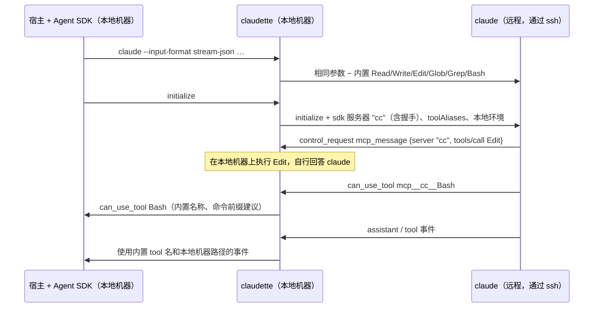
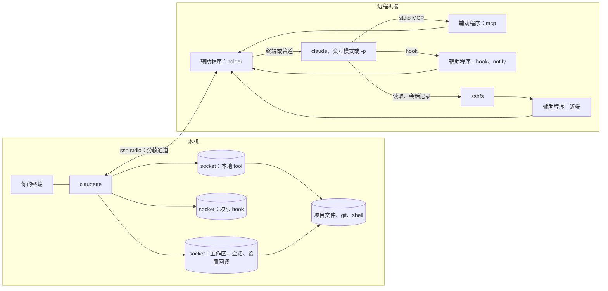
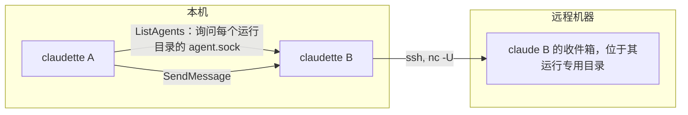

<a id="design"></a>
# 设计

[English](../design.md) · 简体中文

claudette 根据参数选择以下路径之一：

| 参数 | 路径 | tool 如何访问本机 |
|---|---|---|
| Agent SDK 传入的 `--input-format stream-json --output-format stream-json` | SDK 中继（relay） | 通过同一条 ssh 连接上的 SDK 控制通道 |
| Claude Code 自身的命令：`auth`、`doctor`、`--version`、`--help` 等（`mcp` 由 claudette 自行处理，`plugin` 操作本机的插件存储：参见 [MCP server](#tools-settings-and-mcp-servers)和[插件](#plugins)） | 透传，在远程机器上原样运行 | 不需要 |
| `+…`：claudette 自身的命令（`claudette +help`）；前缀由 `prefix` 设置决定 | 本机 | 不需要 |
| 其他情况：交互模式、提示词、`-p` | 直连 | 远程机器上的辅助程序（helper）作为 claude 的 stdio MCP server 和 hook，连接到守护进程（holder）在远端提供并转回本机的 Unix socket |

两条 tool 路径都会挂载工作区、提供相同的本地 tool，并作出相同的权限判断。它们也会将调用方的 tool 限制应用于本地 tool：包括 `--tools`，以及 `--allowedTools` 和 `--disallowedTools` 中不带限定的 tool 名。

<a id="the-workspace"></a>
## 工作区

每次运行都通过 SFTP 提供项目，由辅助程序在远程机器上提供 Unix socket，供 `sshfs -o passive` 挂载。claude 在挂载后的项目中运行：

- 远程目录为 `~/.claudette/ws/<machine>/<name>-<hash>`。`<machine>` 是本机操作系统身份标识的哈希值（macOS 上为硬件 UUID，Linux 上为 `machine-id`），因此无需存储任何标识，给 Mac 改名也不会产生影响；`<hash>` 是项目真实路径的哈希值。每个项目、也就是每个 worktree，都有自己的目录。
- 挂载为只读，Claude Code 自身的文件除外：`.claude/`、`.mcp.json` 和 `CLAUDE*.md`。不会提供 `.git`、`node_modules`，以及 git 忽略的内容（由 `.gitignore` 文件、`.git/info/exclude`、全局排除文件指定），因此远程 Claude Code 的文件索引看到的内容与本地 claude 的 `@` 文件选择器相同，绝不会通过网络遍历构建输出。Claude Code 自身的文件即使被忽略也会显示；在其设置中指定 `"respectGitignore": false` 也会提供被忽略的文件。无法通过 `..` 或符号链接访问项目之外的内容。
- 在 Linux 上，bubblewrap 为每个会话在固定目录处提供独立挂载，因此同一项目中的会话绝不会共用挂载。没有 bubblewrap 时（macOS），挂载点就是该目录本身；若另一个会话已占用它，则使用其同级目录。
- 远程 claude 始终受限运行：在远程主目录中，它只能看到工作区、Claude Code 自身的状态（`~/.claude`、`~/.claude.json`）和安装目录。它不能读取其他项目，也不能在这些范围之外写入。Linux 上由 bubblewrap 强制执行，macOS 上由 `sandbox-exec` 强制执行；两者都没有的远程机器会拒绝启动会话。在 macOS 上，沙箱配置允许访问登录钥匙串：已在该配置下测试通过 `security` tool 和 Security.framework 读取、更新通用密码。
- 无论 claude 如何退出，挂载和本次运行的 socket 都会被移除。如果挂载提前结束（sshfs 崩溃），claudette 会在 stderr 上报告。

远程 claude 通过挂载自行加载项目的设置、skill、命令、agent 和输出样式；`@` 引用和自动补全也会显示你的文件。它自身的文件和 shell 操作仍通过本地 tool 执行。

<a id="the-near-end-of-a-mount"></a>
### 挂载的近端

本机的每个挂载（项目、会话目录、用户内容、插件）都经过远程机器上的辅助程序（`__helper sftp`）；sshfs 与它通信，而不是直接中继到本次运行的 socket。在慢速连接上，claude 通过挂载发出的每个请求都会让它依次等待，因此近端（near end）会直接回答已经知道的内容：

- **预热（warm start）。** 运行开始前，claudette 会向本机各挂载对应的服务器请求 claude 最先读取的内容：服务器问候消息、项目根目录列表、`.claude/` 和 `.mcp.json`、你的 skill、agent、命令和输出样式、插件视图、会话目录列表及其自动记忆。大小不超过 64 KB 的 Markdown 和 JSON 文件会附带内容，每个挂载总计最多 256 KB。这些内容随本次运行的首批帧一起传输。由于回答来自同一个服务器，隐藏名称仍然隐藏，设置文件也以其视图形式到达。挂载就绪、claude 启动时，无需等待本地机器。
- **短时缓存。** 无论来自预热还是后续获取，属性和完整目录列表都可在 10 s 内用于回答请求；完整列表也能回答某个名称不存在。近端下方会关闭 sshfs 自带的缓存，它原本会保留这些内容 20 s。通过挂载进行的变更会使受影响的缓存失效。本地机器上的变更会在这 10 s 内可见，就像之前会在 sshfs 的 20 s 内可见一样。
- 为会话记录（transcript）提供**后写（write-behind）**（参见[会话](#sessions)）。

其余请求仍像之前一样发往本地机器。

环境提示词包含工作目录及其祖先目录的记忆文件。当本地 Read、Edit、Write 或 NotebookEdit 首次操作某个工作目录下的文件时，tool 结果还会包含该路径上每个尚未加载的 `CLAUDE.md`、`.claude/CLAUDE.md` 和 `CLAUDE.local.md`，最近的目录排在最后。`Read` 拒绝规则会跳过相应记忆文件。这与 Claude Code 延迟加载子目录记忆的行为一致，也不会重复提示词中已有的文件。

<a id="the-helper"></a>
## 辅助程序

会话在辅助程序下运行；它就是运行在远程机器上的 claudette 二进制文件。无需安装任何东西：会话首次连接时，claudette 会检查 `~/.claudette/bin/<sha256 prefix>/claudette` 中是否已有远程机器平台对应的构建产物；如果没有，就复制过去（先使用临时名称，校验和验证通过后再重命名；保留最新的两个构建产物）。发行版在可执行文件旁附带 macOS 和 Linux 的 arm64、x86-64 构建产物，因此 本地 Linux 机器可以驱动 Mac，反过来也一样。`claudette +doctor` 会执行同样的检查，并报告辅助程序的版本。

会话从启动起就一直保持其构建产物的文件句柄打开。`claudette +update` 会通过重命名，用新构建产物覆盖它们，因此此前启动的会话会重新连接到启动时的辅助程序；如果远程机器删除了它，还会重新复制那个构建产物，而不是使用从未计算过校验和的其他构建产物。下一个会话会在两台机器上运行新构建产物。

每次运行时，辅助程序都会启动一个脱离 ssh 的守护进程，将状态保存在 `/tmp/claudette-<run>.*` 中（权限为 0600，结束时移除）。守护进程运行 claude（交互界面使用它自己持有的终端，其他情况使用管道），并提供本次运行的 Unix socket：本地 tool、权限 hook、挂载和设置回调。所有内容都通过 ssh 自身的 stdio 传输，采用双方分别确认的编号帧，而不是 `ssh -R` 转发，因此某次运行崩溃时，不会在共享 ssh 连接上留下任何东西。

私密内容不会出现在远程命令行上，因为远程机器上的任何用户都能读取命令行（`ps`）。claude 的环境随本次运行的第一帧到达，由守护进程设置；会话设置、追加的系统提示词（你的 `CLAUDE.md` 文件、git 状态）、MCP 配置和挂载预热数据则是仅远程用户可读的文件，在启动帧之前以帧形式发送，由守护进程写入，结束时移除。首次连接会在自己的问候消息之后立即发送它们，无需等待辅助程序的问候消息。原样透传的命令（`claude auth`、`--version`）也从这种文件获取环境：先通过 ssh 的 stdin 保存，再在 claude 启动前读取并移除。

连接中断时（本地机器休眠、网络切换、ssh 终止），会话会等待，而不是结束：

- claude 继续在远程机器上运行。它通过挂载发出的读取、tool call 以及发给它的消息只会等待，不会失败。
- claudette 会通过新的 ssh 连接重连，首次等待一秒，随后逐步退避至每 15 秒一次，并在 stderr 上报告。双方都会重发对方尚未确认的帧，因此不会丢失或重复任何内容。
- 对于 claudette 始终未返回的会话，守护进程会保留 `detach_timeout` 指定的时间（默认为 12 小时），然后停止 claude 并清理。新的 claudette 不能接管等待中的会话：如果本机进程已不存在，会话也就不存在了。

辅助程序在沙箱外运行；claude 及其启动的所有进程都留在沙箱内。

<a id="sessions"></a>
## 会话

项目会话保存在本机的 `~/.claude/projects/<project>` 中（或 `CLAUDE_CONFIG_DIR` 下），与本地 claude 的保存位置相同。每次运行也会通过 SFTP 提供该目录。远程机器将其挂载，本次运行独有的 Claude Code 目录会将它呈现为工作区对应的 claude 会话目录 `projects/<workspace>`（参见[tool、设置和 MCP server](#tools-settings-and-mcp-servers)）。挂载点位于该目录旁，而非内部，因为 macFUSE 和 fusermount 都不允许在 FUSE 卷上挂载。因此，无需复制就能实现：

- `--continue`、`--resume <id>` 和 `/resume` 列表能看到项目的每个会话：既包括切换前本地 claude 写下的，也包括通过终端或宿主（host）由 claudette 启动的。
- 宿主能在预期位置找到会话记录（T3 Code 恢复线程前、SDK 的 `forkSession`），在本机创建的分支会话也能在远程机器上恢复。
- 远程机器不会在磁盘上保留会话历史。首次运行时，它之前为该项目保存的会话会移入本机目录（移动失败时，下次运行会重试）。
- claude 写入的内容会逐个完整行地将远程目录路径转换为本机路径，因此会话记录与本地 claude 的一致。无法通过 `..` 或符号链接访问目录之外的内容。

会话记录只由所属会话的 claude 写入，不会有其他写入者，因此会话挂载的近端采用后写。它会为 claude 创建或追加的每份会话记录保留副本，内容与本机保存的一致（使用同一段代码将远程路径转换为本机路径），并立即响应 claude 对它的打开、写入、查找和读取。每次写入仍会在发生时按顺序发往本机，使用近端选定的句柄，因此本地机器无需等待打开操作，本机读取会话记录的 hook 也能看到 claude 在运行 hook 前写下的内容。本机的响应仅用于检查：本机拒绝某次写入时，claude 对该文件的下一次写入或关闭会失败；本机拒绝打开时，副本会被丢弃，之后重新由本机提供会话记录。通知会立即输出到 stderr；使用终端时则在会话结束后输出，因为在此之前终端由 claude 的界面占用。本机离线期间，近端仍会响应写入，直到待发送数据达到 16 MB；之后 claude 的后续请求也会等待。会话结束时会等待本机确认最后一次写入。正在恢复的会话记录（`--resume <id>`，或 `--continue` 恢复的最新记录）会完整随预热数据传输，上限为 8 MB；其他被 claude 打开以追加的记录会先通过批量发送的读取请求获取，上限相同。更大的记录则直接写穿，每次写入需要一次往返。

使用独立会话存储的宿主（`--session-mirror`）仍会收到 claude 的镜像帧，路径符合其存储的预期。

项目的两个设置文件会通过视图传给 claude：

- 命令 hook（shell 形式，或带 `args` 的 exec 形式）、状态行（`statusLine`、`subagentStatusLine`）和 `fileSuggestion` 会转换为对本机的回调；命令在本机项目中运行，hook 的输入也会本地化（路径，以及将 `mcp__cc__Write` 转为 `Write`）。格式化 hook 会在本机改写你的文件。退出码为 2 的 hook 会像本地一样阻止操作。
- 其他类型的 hook 留在远程机器上，由 Claude Code 执行：`http` hook 的请求从远端发出，`prompt` hook 是一次模型调用，`agent` hook 的 subagent 获得会话的 tool（包括本地 tool），`mcp_tool` hook 则调用服务器，无论服务器运行在哪里。
- CwdChanged 和 FileChanged 在本机触发，绝不会在远程机器上触发，因为远程 claude 没有自己的 shell，也看不到你的文件变化：本地 Bash tool 的 `cd` 改变目录时触发 CwdChanged；shell 所在目录中匹配其匹配器的文件（或 hook 的 `watchPaths`）被创建、修改或删除时触发 FileChanged，每秒检查一次。SessionStart、Setup、CwdChanged 和 FileChanged hook 写入 `CLAUDE_ENV_FILE` 的内容会传给本地 Bash tool 后续执行的命令；CwdChanged 和 FileChanged 写入的内容会在下次目录切换时丢弃。
- 指定被替换 tool 的规则和匹配器（`Write`、`Edit|Write`）也覆盖本地 tool，`Bash(…)` 规则对本地 Bash 同样有效。
- claude 写回的内容，例如为项目保存的“始终允许”，会先做反向转换，因此本地机器上的 `.claude/settings.local.json` 会是 `"allow": ["Write"]`，与本地 claude 写入的内容一致。

<a id="tools-settings-and-mcp-servers"></a>
## tool、设置和 MCP server

远程 claude 会获得明确的内置 tool 列表（`--tools`）：保留会话内部操作或访问网络的 tool，例如 Task、Skill、WebFetch 和 WebSearch，并受调用方自身的 `--tools` 进一步限制。文件和 shell tool 会替换为本地 tool，ListAgents 和 SendMessage 也是如此（参见[会话互通](#sessions-reaching-each-other)）。LSP、Monitor 和 worktree tool 被关闭；新版 Claude Code 新增的任何内置 tool，在 claudette 明确列出前也都关闭。

它会加载调用方要求的设置来源（默认全部加载），并且只加载 claudette 传入的 MCP server（`--strict-mcp-config`）。

它的 Claude Code 目录（`CLAUDE_CONFIG_DIR`）是本次运行独有的，由远程机器上的辅助程序提供，通过 sshfs 挂载在 `/tmp/claudette-<run>.config`。各文件分别来自所属位置：

- **来自本机**： `~/.claude/settings.json`、`keybindings.json`，以及 `skills`、`agents`、`commands` 和 `output-styles`。后四者来自你的只读挂载，无法通过它访问 `~/.claude` 中的其他内容（凭据、会话、历史、缓存）。插件来自各自独立的挂载（参见[插件](#plugins)）。
- **来自远程用户，并由所有本地机器及远程机器上直接运行的 claude 共享**： `~/.claude.json`（初始引导、目录信任、账号）和 `~/.claude` 的其余内容（历史、插件、缓存）。
- **登录信息**根本不在该目录中。`CLAUDE_SECURESTORAGE_CONFIG_DIR` 将其保留在 Claude Code 一贯使用的位置：macOS 上的钥匙串，Linux 上的 `~/.claude/.credentials.json`。

因此，每台本地机器的会话使用各自的配置，远程机器自身的 `~/.claude/settings.json` 不参与其中。

你的设置会通过与项目设置相同的视图传给远程 claude：hook 和状态行回调本机，指定被替换 tool 的规则也覆盖本地 tool。本机专属的内容不会传过去：登录信息（`apiKeyHelper`、云凭据辅助程序以及 `env` 中的凭据）、指定本机路径或会话的 `env` 变量（参见[配置](configuration.md#configure)）、插件和市场，以及 `permissions.additionalDirectories`（改在本机应用；见下文）。

会话保存到这两个文件中任意一个的内容，都会回到你的 `~/.claude`：宿主或终端保存到用户设置中的“始终允许”、主题、`/config` 选项。claude 保存时会在原文件旁写入临时文件，再重命名覆盖原文件。辅助程序会将这种保存操作留在文件所属的一侧，并在落盘后立即发送到本机；claudette 会等到这些内容到达才结束。保存以变更的形式应用：会话相对于收到的初始内容修改的规则和键，会合入你当前的文件。因此本机专属的键会保留，你在此期间在本机做出的编辑也会保留，除非会话修改了同一个键。应用前会先撤销视图转换，因此文件中的内容是 `"allow": ["Write"]`，与本地 claude 写入的一致。

两个会话通过各自的挂载锁定并改写 `.claude.json`，因此该目录的挂载不缓存任何内容（关闭 sshfs 的目录缓存，以及内核的名称、属性缓存；macOS 上还关闭数据缓存）。启用这些缓存时，一个会话最多会在另一个会话释放锁后 20 s 内仍看到该锁；在 macOS 上，还可能覆盖另一个会话的修改。状态读取访问的是同一台机器上的服务器，耗时约半毫秒。

你的 `~/.claude/CLAUDE.md` 会与项目的记忆文件一起进入环境提示词。这些文件中的导入会在本机按 Claude Code 的规则展开：相对路径从导入它的文件解析，`~/` 从主目录解析，按深度优先顺序处理，因此被导入的指令位于引用它的文件之前。循环和重复路径只包含一次，缺失的导入会跳过，导入最多深入四跳。

有些设置只对 tool 有意义，但 claude 将这些 tool 视为 MCP tool，无法对它们应用相应设置。claudette 会自行应用这些设置，来源包括 claude 加载的每个设置文件（用户、项目、本地、调用方的 `--settings`），以及 `--allowedTools` 和 `--disallowedTools`：

- `Bash(…)` 规则，与之前相同。
- `Read(…)` 和 `Edit(…)` 路径规则，遵循 Claude Code 的语义：以 `//`、`~/`、`/`（设置文件自身的根目录）或工作目录为锚点的 gitignore 模式；deny 优先于 ask，ask 优先于 allow；`Read` 覆盖 Read、Glob 和 Grep，`Edit` 覆盖 Edit、Write 和 NotebookEdit，`Read` 的 deny 还会阻止 Edit 和 Write。tool 运行时会再次检查 deny，因此任何批准（预先批准、模式、宿主的回答）都不能解除它，搜索也会排除被拒绝的文件。对于 ask 规则，远程 claude 会获得覆盖相应 `mcp__cc__*` tool 的 ask 规则，因此即使不带限定的 allow（`Write`）覆盖该 tool，调用仍会进入权限检查；随后 claudette 会批准 ask 规则未覆盖的调用，与该 allow 原本的作用一致。
- `env`，用于本机启动的 Bash tool 命令、hook 和 MCP server（不包括提供商变量）。
- `permissions.additionalDirectories`（`~/` 和相对路径按 Claude Code 的方式展开）：为本地 tool 添加工作目录，与 `--add-dir` 的效果相同。

每个 MCP server 都在本机定义，并指定运行位置：

| 定义位置 | 运行位置 |
|---|---|
| `~/.config/claudette/mcp.json`：用户作用域，或此项目的本地作用域 | 使用 `--remote` 添加的服务器运行在远程机器上（其余在本机） |
| 项目的 `.mcp.json`，批准后 | 本机 |
| 本机的 `~/.claude.json`：用户作用域，以及此项目的本地作用域 | 本机 |
| 宿主的 `--mcp-config` 或 `setMcpServers`，以及其进程内服务器 | 本机（进程内服务器留在宿主中） |

使用 `claude mcp` 管理它们。它像 Claude Code 一样操作本机文件（用户和本地作用域位于 `~/.claude.json`，项目作用域位于 `.mcp.json`），另支持 `--remote`，将服务器保存在 claudette 自己的文件中：

```sh
claude mcp add --scope user fs -- npx @modelcontextprotocol/server-filesystem .
claude mcp add --remote --transport http docs https://example.com/mcp -H 'Authorization: Bearer …'
claude mcp add --scope project lint -- node tools/lint-mcp.js    # 写入 .mcp.json
claude mcp list
claude mcp remove docs
```

无法解析的 `~/.claude.json` 会保持原样，而不会被改写。添加服务器时，是否使用 `--remote` 会决定将它移动到两个文件中的哪一个。不支持 `claude mcp serve`、`add-from-claude-desktop` 和 `reset-project-choices`。

名称冲突时，宿主的服务器优先，其次是 claudette 自己的服务器（本地作用域优先于用户作用域），然后依次是 `~/.claude.json` 的本地作用域、项目的 `.mcp.json`、`~/.claude.json` 的用户作用域。`${VAR}` 和 `${VAR:-default}` 从本机环境展开，远程服务器也一样。

- 本机运行的服务器通过中继或辅助程序提供的 socket 连接到 claude，因此本地机器 `localhost` 上的服务器（T3 Code 会运行一个）也能正常工作，请求头中的令牌始终留在本地机器上。桥接会原样转发 MCP tool、资源、提示词、补全和服务器通知。对于 Streamable HTTP，它还会保持可选的 GET 事件流打开，并在断开后恢复。
- 远程服务器由远程 claude 在沙箱内启动，工作目录为挂载的项目。其定义以仅远程用户可读的文件形式传到远程机器，随本次运行的首批帧发送，结束时移除，绝不出现在命令行上。
- `.mcp.json` 中的服务器获批后才会运行，正如 Claude Code 会在启动前请求批准一样：批准记录位于 `.claude/settings.local.json` 或 `.claude/settings.json` 的 `enabledMcpjsonServers`（或 `enableAllProjectMcpServers`）中，或 `~/.claude.json` 中该项目的条目中。claudette 会列出尚未批准的服务器。`claude mcp add --scope project` 会批准其添加的服务器。
- `claude plugin …` 在本机的插件存储上运行 Claude Code 自身的插件命令（参见[插件](#plugins)）。

<a id="plugins"></a>
### 插件

会话获得的插件与 Claude Code 在本机加载的相同：已安装在本机（`~/.claude/plugins/installed_plugins.json` 中，属于用户或此项目；项目的安装优先），或在 `enabledPlugins` 中指定，并且已启用。启用状态依次由 `--setting-sources` 加载的用户、项目和本地设置中的 `enabledPlugins`、调用方的 `--settings`，以及优先级最高的托管设置文件决定；若没有任何设置指定某插件，则由其清单的 `defaultEnabled` 决定（除非为 `false`，否则启用）。每个插件都通过 SFTP 只读提供，挂载到 `/tmp/claudette-<run>.plugins/<name>-<marketplace>`，并通过 `--plugin-dir` 加载，因此其 skill、agent、命令和输出样式都来自本地机器。项目设置和调用方 `--settings` 的视图会去掉 `enabledPlugins` 和 `extraKnownMarketplaces`，因此远程 claude 不会安装或加载远程机器上的任何插件；保存项目设置时，会保留本机文件中这些字段的原值。

插件的 hook 和 MCP server 在本机运行：

- hook 文件（`hooks/hooks.json` 及其清单指定的文件）和内联 hook 通过与设置相同的视图处理，因此命令 hook 会回调本机，并带上 `CLAUDE_PLUGIN_ROOT`、`CLAUDE_PLUGIN_DATA`（`~/.claude/plugins/data/<id>`）和 `CLAUDE_PLUGIN_OPTION_<KEY>`。
- MCP server（先是 `.mcp.json`，然后是清单声明的 JSON 文件和内联映射）加入本机运行的服务器，命名为 `plugin_<plugin>_<server>`，让 tool 保留 Claude Code 的名称（`mcp__plugin_<plugin>_<server>__<tool>`）。挂载会隐藏 `.mcp.json` 以及清单中对这些服务器的声明。同名时，调用方的服务器优先。

插件选项（`userConfig`）使用 Claude Code 在本机保存的值：用户设置、调用方 `--settings` 和托管设置中的 `pluginConfigs`，敏感值来自 Claude Code 的凭据存储（macOS 上为钥匙串条目 `Claude Code-credentials` 中的 `pluginSecrets`，或 `~/.claude/.credentials.json`；仅为具有敏感选项的插件读取），最后使用各选项的默认值。这些值在本机填入 MCP server 和 exec 形式 hook 参数中的 `${user_config.KEY}`。远程 claude 通过 `--settings` 收到非敏感值，放在它为 `--plugin-dir` 插件指定的 id（`<name>@inline`）下，并自行将值填入插件的 skill 和 agent。

`claude plugin …`（install、enable、marketplaces 等）使用远程机器的 Claude Code 操作本机存储：本机的暂存目录通过 SFTP 提供并挂载到 `/tmp/claudette-<run>.store`，作为它的 Claude Code 目录，其中 `plugins` 和 `settings.json` 指向 `~/.claude` 中的对应内容，它写入该目录的其他所有内容都会在结束时丢弃；命令在暂存目录的 `project` 中运行，该目录的 `.claude/settings.json` 和 `settings.local.json` 指向此项目的对应文件（用于 `--scope project` 和 `local`）。命令指定的本地目录（`marketplace add ./market`），以及存储已记录的本地市场，会以只读方式挂载在旁边。记录路径的文件（`installed_plugins.json`、`known_marketplaces.json`、设置文件）读取时使用挂载路径，写回时使用本机路径，因此最终存储与本地 claude 操作后的结果一致。远程机器上不会安装任何东西。

<a id="sdk-relay"></a>
## SDK 中继

Agent SDK 使用 stream-json 控制协议，通过 stdin 和 stdout 与 `claude` 通信。claudette 替代该程序，通过 `ssh -T` 在远程机器上启动真正的 `claude`，并双向改写消息。



远程 claude 运行时关闭其内置文件和 shell tool。claudette 提供名称和输入相同的本地版本，作为名为 `cc` 的 MCP server，由自身通过控制通道提供服务。服务器握手随 `initialize` 一起发出，为 claude 节省两次往返。

宿主绝不会看到 `mcp__cc__` 名称或远程目录。tool call 显示为 `Read`、`Edit` 和 `Bash`，使用本地机器路径；权限请求也以相同名称传给宿主。在 acceptEdits 模式下，工作目录内的编辑会按 Claude Code 批准自身 tool 的方式获批。已批准的命令前缀，例如 `npm test:*`，会覆盖后续命令，但绝不覆盖使用 `;`、`&&`、`|` 或 `$(…)` 的复合命令；保存到项目设置后，它在之后的会话中也有效。

会话记录通过挂载的会话目录传输（参见[会话](#sessions)）。

<a id="direct"></a>
## 直连

Claude Code 的交互界面和 `-p` 没有可通过管道提供 tool 的宿主，因此改为通过普通 stdio MCP server 访问本地 tool：



claude 将 tool 列为 `mcp__cc__Read`、`mcp__cc__Edit` 等。这些 tool 的 stdio MCP server 就是辅助程序（`__helper mcp`）；它根据随本次运行发送的 tool 列表回答握手（`initialize`、`tools/list`、`server/discover` 探测），并将 tool call 等其余所有内容转发到本机 socket：claude 能提前三次往返带着 tool 启动。在本机，这些 socket 位于本次运行的目录中（权限为 0700，见下文）。在远程机器上，守护进程以 0600 权限创建对应端点，并在运行结束时移除。

Claude Code 只对自身 tool 应用 acceptEdits 和 Bash 命令规则。为了覆盖本地 tool，claudette 会向本次运行的设置添加一个 `PreToolUse` hook。claude 会将当前模式告知 hook，因此 acceptEdits 下工作目录内的编辑直接放行，命令行或项目设置中的 `Bash(…)` 允许和拒绝规则也会作用于本地 Bash。其他情况使用 claude 通常的询问提示，或采用其模式对应的回答（`dontAsk` 会拒绝）。Bash 调用的判断在远程机器上完成（`__helper hook`）：判断只依赖会话的 Bash 规则，而这些规则在没有宿主的会话中始终不变，因此本机只会收到结果通知，每次本地 Bash 调用只需一次往返，即调用本身。编辑和读取在本机判断，因为路径规则需要解析你的文件。`UserPromptSubmit`、`Stop` 和权限提示的 `Notification` hook 会告知 claudette 会话是在工作、空闲还是等待输入；claude 不会等待它们（`__helper notify`）。每个通知都带有远程机器的发送时间；由于两个通知可能乱序到达，本机不会让较旧的通知改变状态。

本地机器的环境、git 状态和 `CLAUDE.md` 文件放入 `--append-system-prompt`。与中继模式一样，会话保存在挂载的会话目录中，因此 `claudette --continue` 和 `--resume <id>` 也能接续 T3 Code 或 Paseo 启动的会话。

<a id="sessions-reaching-each-other"></a>
## 会话互通

Claude Code 的 ListAgents 和 SendMessage 通过该用户所有 claude 共享的注册表（`~/.claude/sessions`）查找会话。在远程机器上，这会包括那里的所有会话：同一账号下其他本地机器的会话，以及直接在远端启动的会话。因此内置版本保持关闭，名称和输入相同的本地版本只访问本机的 claudette 会话：



- **没有注册表。** 每次运行都会在此用户的运行时目录中创建 `claudette-<pid>-XXXXXX` 目录：macOS 上使用用户专属临时目录，其他平台使用 `XDG_RUNTIME_DIR` 或私有的 `/tmp/claudette-<uid>`；无论进程如何启动，同一用户的所有进程使用的都是同一个位置。该目录存放本次运行的 socket、`agent.sock` 和本地 Bash tool 的临时文件，并在运行结束时移除。ListAgents 会询问每个有响应的 `agent.sock`，因此列表始终是最新的；进程已不存在的目录会被移除。只有此用户能连接（0700，并检查所有权）。
- **名称。** 会话以项目目录名或 `--name` 命名；`name [id]` 用来区分同名会话。ListAgents 显示每个会话的项目路径，以及工作、空闲或等待输入的状态。
- **投递。** 消息发给目标会话自己的 claudette，再由它交给远程机器上的守护进程。claude 将辅助程序作为不提供 tool 的 MCP server（`claudette-inbox`）启动，因此它属于 claude 自己的进程；守护进程将消息传给它，再由它投递到 claude 的收件箱，位于本次运行的专用目录中（`CLAUDE_CODE_TMPDIR` 设为 `/tmp/claudette-<run>.inbox`，运行结束时移除）。claude 将自身进程投递的内容视为来自自身，因此即使会话跳过权限提示，消息也能送达。claude 仍会将它视为来自另一个会话，而不是你输入的内容：它不能批准任何操作，接收会话的权限仍然适用。消息会注明发送者及回复方式。
- **`notify_when_idle`。** 目标会话在下次完成一轮或结束时发送一次通知；如果已经空闲，则立即发送。
- **agent 团队保持关闭**：无论 tool 列表如何配置，其队友都会获得 Claude Code 的 SendMessage。claudette 会在远程环境和 `--settings` 中设置 `CLAUDE_CODE_EXPERIMENTAL_AGENT_TEAMS=0`，它们的优先级高于你的设置。按名称继续已完成的 subagent 也不可用，因为该功能同样使用 Claude Code 的 SendMessage。
- **拒绝后台会话**：`claude agents`、`attach`、`respawn`、`stop`、`kill`、`rm`、`logs` 和 `--bg` 会将会话放进远程机器上的 Claude Code 后台服务运行，该服务承载远程用户的所有后台会话：从 claudette 会话交给它的会话会脱离沙箱（已在 Linux 上使用 Claude Code 的服务测试，也在 macOS 上使用 `sandbox-exec` 和替代服务测试），而且会比本次运行的 socket 存活得更久。会话内的 `/bg`、空提示词时的 `←` 和“移至后台并退出”也会产生相同效果，因此 claudette 会在其中关闭 agent 视图（在 `--settings` 中设置 `disableAgentView`，在环境中设置 `CLAUDE_CODE_DISABLE_AGENT_VIEW`）。

远程机器本身的会话仍可向 claudette 会话发送消息：远程机器的注册表会列出它；不带发送者凭据的消息也会投递，除非接收会话跳过权限提示（此时消息会保留至获批；在无法显示批准界面的宿主或 `-p` 会话中，五分钟后丢弃）。
